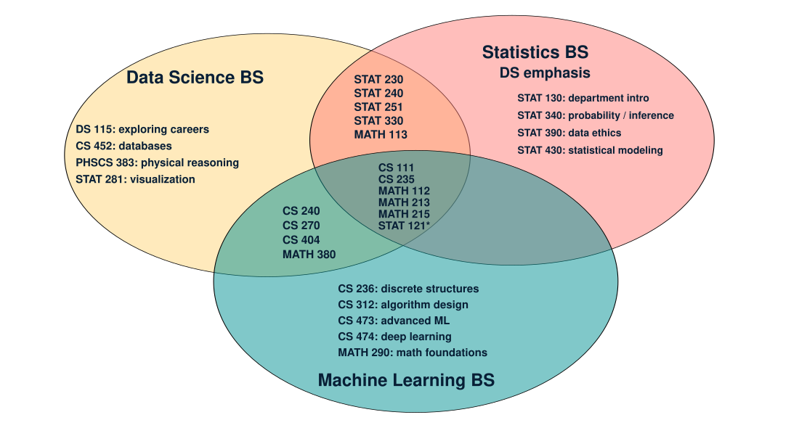

---
format:
  revealjs:
    css: day4.css
    title-slide: false
    pdf-max-pages-per-slide: 1
---

## Day 4: Academic Pathways {.title-slide}

::: {.big-idea}
How can your BYU education prepare you for the work you want to do?
:::

DS 115: Exploring Data Science

::: {.notes}
Designed for a 50-minute class, including discussion and live demonstrations. The final three slides are reference material. Open the five program catalog pages, the DS MAP sheet, MyMAP, and the CMS Advisement Center page before class. The live catalog comparison is a central activity.
:::

## Where we left off {.question-slide}

::: {.prompt}
What did the job postings tell us about the skills people use?
:::

::: {.supporting}
Recall one responsibility and one skill. Compare with a neighbor.
:::

::: {.fragment}
Different jobs draw on different combinations of **computing, statistics, mathematics, communication, and context**.
:::

::: {.notes}
Allow 30 seconds of individual recall, then hear two or three examples. Connect Day 1's breadth, Day 2's student-success investigation, and Day 3's actual responsibilities. If students missed Day 3, ask what expertise the GPA investigation required instead.
:::

## Today's question {.section-card}

::: {.big-idea}
How can these academic pathways help you grow into data science?
:::

::: {.supporting}
You can begin learning while you are still figuring out your direction.
:::

::: {.notes}
Students do not need an established career goal or a final major choice. Today we explain the programs and show resources that can help them start.
:::

## What you should leave with

- An understanding of **why the DS degree includes different disciplines**.
- A way to compare majors using **their actual requirements**.
- Resources to help you **begin your graduation plan and get advice**.

::: {.notes}
The course assignment asks for a graduation plan. Today introduces the resources, rather than requiring students to build a complete plan during class.
:::

## The curriculum helps you learn the work

You are here to develop these abilities. You do not need to arrive with them.

| As you move through the degree... | You learn how to... |
|---|---|
| Mathematics | Understand the structure behind models |
| Statistics | Evaluate evidence and uncertainty |
| Computing | Work with data and build reliable programs |
| Courses that bring them together | Use these foundations in real investigations |

::: {.notes}
Explain this table yourself. Do not ask students to diagnose a process they have not yet learned. Briefly refer to the GPA investigation: we saw several kinds of work, and the curriculum gives students time and support to learn them. The disciplines overlap. This is a purpose statement, not a division of tasks into exclusive departments.
:::

## The structure of the Data Science BS

| Part of the degree | What it develops |
|---|---|
| Introductory courses | A starting vocabulary and basic tools |
| Mathematical foundations | A language for models and computation |
| Statistical foundations | Reasoning about evidence and uncertainty |
| Computing foundations | Reliable programs and organized data |
| Data science core | Practice combining the foundations |
| Electives and specialization | More depth in areas you want to explore |
| Advanced theory and experience | Deeper models, capstone work, or research |

::: {.supporting}
View the [actual Data Science BS requirements](https://catalog25byu.catalog.prod.coursedog.com/programs/cCQhj7GN2hR4tO4DD4yL/program-information-aoYks).
:::

::: {.notes}
Source: https://catalog25byu.catalog.prod.coursedog.com/programs/cCQhj7GN2hR4tO4DD4yL/program-information-aoYks, reviewed October 5, 2026 UTC. Open the actual DS program page and point out its seven requirement areas. Then use the next slides to discuss the purpose of each area. This table is a conceptual interpretation, not a prerequisite chart. Explain that students should use the catalog year attached to their own degree audit.
:::

## Requirement 1: Introductory courses

| Courses listed in the introductory block | Starting point |
|---|---|
| DS 115 | Explore the field and possible pathways |
| DS 180 | Begin working with data science ideas |
| CS 111 | Build a programming foundation |
| MATH 112 | Develop calculus tools |
| STAT 121 | Begin statistical reasoning |

::: {.supporting}
Use your degree audit and advisor to confirm how prior credit and introductory requirements apply to you.
:::

::: {.notes}
The linked 2025-2026 catalog lists four introductory courses plus one introductory data science course selected from its two cross-listed options. Use current DS prefixes in conversation. The MAP sheet uses the legacy labels STAT 115 and CS 180. Confirm how those labels and any prior credit apply through the student's own audit and advisor.
:::

## Requirement 2: Mathematical foundations

**MATH 113, MATH 213, MATH 215**

::: {.prompt}
How does a model combine information from many variables?
:::

::: {.fragment}
Calculus helps us describe change. Linear algebra helps us represent and compute with many quantities at once.
:::

::: {.supporting .fragment}
Think back to using several student characteristics to predict GPA.
:::

::: {.notes}
Course membership source: Data Science BS catalog. The explanation is an instructional illustration of why mathematical foundations matter. Do not introduce equations or teach calculus here. Ask students where changing one input might matter in a prediction.
:::

## Requirement 3: Statistical foundations

**STAT 230, STAT 240, STAT 251, STAT 330**

::: {.prompt}
What does the evidence support, and how uncertain are we?
:::

- Study design and statistical modeling.
- Probability, inference, and Bayesian reasoning.

::: {.supporting .fragment}
A relationship in the GPA data did not automatically tell us what causes student success.
:::

::: {.notes}
Sources: Data Science BS catalog, https://catalog25byu.catalog.prod.coursedog.com/programs/cCQhj7GN2hR4tO4DD4yL/program-information-aoYks. Course examples: STAT 230, https://catalog.byu.edu/courses/11839-001, and STAT 330, https://catalog.byu.edu/courses/11842-001. Ask students to recall one reason they were cautious about the Day 2 predictions. Keep the focus on reasoning rather than memorizing course numbers.
:::

## Requirement 4: Computing foundations

**CS 235, CS 240, CS 452**

::: {.prompt}
How will you make the work reliable when the data and code get larger?
:::

- Data structures and algorithms.
- Software design and testing.
- Database organization and access.

::: {.supporting .fragment}
Think back to the pipelines and systems in the Day 3 postings.
:::

::: {.notes}
Sources: Data Science BS catalog. CS 235, https://catalog.byu.edu/courses/10648-000. CS 240, https://catalog.byu.edu/courses/09200-000. Ask why a script that works once might still be inadequate for a company that must run it every day.
:::

## Requirement 5: Data science core

| Course | A question it helps you approach |
|---|---|
| CS 270 | How can a model learn from examples? |
| CS 404 | How should technology affect people? |
| MATH 380 | What mathematics supports data science? |
| PHSCS 383 | How does knowledge of a system guide reasoning? |
| STAT 281 | How can a visual communicate evidence? |
| STAT 386 | How do we carry out an analysis with data? |

::: {.notes}
Course membership source: Data Science BS catalog. The questions are teaching summaries, not quoted official learning outcomes. Invite students to connect one course to an actual responsibility from Day 3. The courses combine perspectives rather than belonging to isolated categories.
:::

## Requirement 6: Electives and specialization

The degree includes **12 hours of approved electives**.

| A direction you could explore | Examples from the approved list |
|---|---|
| Deeper modeling and theory | Advanced ML, deep learning, probability and inference |
| Mathematical methods | Numerical linear algebra and model uncertainty |
| Data science in other fields | Bioinformatics, economics, and geoscience |
| Work on larger projects | Capstone coursework and approved internship credit |

::: {.supporting}
You can use these choices to develop interests you discover along the way.
:::

::: {.notes}
Requirement 6 is a broad elective block. Applied context describes some options, but it does not describe the whole list. Some choices deepen methods and theory. These rows are examples, not prescribed tracks or approved bundles. Check the approved list, prerequisites, and offerings. Some options require prerequisites beyond the major. BIO 462 is marked as no longer offered.
:::

## Requirement 7: Advanced theory and experience

Choose **3 hours from the approved list**.

| Some options deepen theory and methods | Others emphasize experience |
|---|---|
| CS 473: Advanced Machine Learning | CS 483: Data Science Capstone 2 |
| CS 474: Deep Learning | Approved undergraduate research |
| MATH 522: Mathematics of Deep Learning | Approved internship credit |
| STAT 486: Machine Learning | Approved physics capstone or research |

::: {.key-idea .fragment}
A course used here cannot also count toward Requirement 6.
:::

::: {.notes}
This requirement includes advanced ML/DL and mathematical theory as well as culminating experiences. Do not frame all options as a capstone or internship. The table gives examples, not the entire approved list. Confirm the required three hours, variable-credit rules, and any permissions or preceding courses. Source: the DS catalog linked in this deck.
:::

## Different majors, different priorities {.section-card}

::: {.big-idea}
We have seen how the Data Science BS combines these foundations. How do other programs arrange them?
:::

::: {.supporting}
The requirements show what each pathway asks you to practice in greater depth.
:::

::: {.notes}
Move from understanding the DS curriculum to examining the actual requirements of related programs. Students can now recognize the role of introductory courses, foundations, electives, and advanced work. Introduce the comparison questions, then use the five-link slide for the live catalog tour.
:::

## Questions for reading a degree's requirements

- Which foundations does it share with Data Science?
- Where does it build more depth?
- Where do students have a choice?

::: {.supporting}
We will look at the requirements together. You can notice differences without deciding on a major today.
:::

::: {.notes}
Keep the comparison descriptive and instructor-led. Point out concrete courses and explain their role. Invite observations about material just shown. Avoid asking students to infer a career fit or rank programs.
:::

## Five data science pathways at BYU {.demo-slide}

- [Data Science BS](https://catalog25byu.catalog.prod.coursedog.com/programs/cCQhj7GN2hR4tO4DD4yL/program-information-aoYks)
- [Statistics BS, Data Science emphasis](https://catalog.byu.edu/programs/34708)
- [Machine Learning BS](https://catalog.byu.edu/programs/34716)
- [Mathematics BS, Applied and Computational Mathematics emphasis (ACME)](https://catalog.byu.edu/programs/34703/program-information-aoYks)
- [Applied Physics BS, Data Science emphasis](https://catalog.byu.edu/programs/ycqlYlXfYC0FzhUQ6ojv)

::: {.supporting}
We will look through the actual program requirements together.
:::

::: {.notes}
Use this slide as the starting point for a live catalog comparison. Open the links in separate tabs and scroll to Program Requirements. We have just discussed the DS requirement areas, so revisit its structure briefly, then compare Statistics, Machine Learning, ACME, and Applied Physics. Allow about 8 minutes for the tour, with short student observations along the way. Look for fixed courses, choices, and prerequisite sequences. Ask what each program adds in depth and what room it leaves for exploration. ACME has a structured junior/senior core and a concentration. Applied Physics connects data methods to physics and research. Invite students to point to specific requirements that support those interpretations. The shared-foundation slide and updated Venn diagram provide the debrief. The DS link is the instructor-supplied 2025-2026 edition. The other links open the current catalog. Sources reviewed October 5, 2026. Each student should use the catalog year attached to their own degree audit.
:::

## A shared foundation

**Data Science BS**, **Statistics BS, Data Science emphasis**, and **Machine Learning BS** share substantial early coursework.

::: {.statement}
CS 111, CS 235, MATH 112, MATH 213, MATH 215, STAT 121*
:::

::: {.supporting}
*Machine Learning allows STAT 201 as an alternative to STAT 121.
:::

::: {.fragment}
Learning these foundations gives you time to discover which parts of the field you enjoy.
:::

::: {.notes}
This is a selected list, not a full list of overlap. Include STAT 121 explicitly. It is required in DS and Statistics, and is one of two introductory statistics options in ML. Approved prior credit and substitutions can affect an individual plan. Sources: the three program catalogs linked in the lecture.
:::

## Overlapping foundations, different depth {.major-overlap-slide}

{.major-overlap width=100%}

::: {.supporting .venn-note}
Selected core requirements. *ML allows STAT 201 instead. A course outside a program's core may still be an elective.
:::

::: {.notes}
Adapted from the Venn diagram in last year's supplied deck. The center highlights early overlap, including STAT 121 with the ML alternative marked. DS and Statistics share MATH 113 and STAT 230, 240, 251, and 330. DS and ML share CS 240, 270, 404, and MATH 380. Outer regions give selected core examples, not exclusive access to those courses. For example CS 452 and STAT 240 are ML elective options. STAT 386 is not placed among fixed shared requirements because Statistics offers a capstone alternative to the STAT 386/486 path. Update from last year: current Statistics requirements list STAT 430 rather than STAT 250. Intro to data science uses different cross-listed prefixes, so it is omitted from this selected diagram. Use the actual program pages for every requirement. Invite a simple observation about the overlap or a difference students just saw.
:::

## A starting point when you are unsure

::: {.big-idea}
If you are unsure which pathway to pursue, start with the Data Science BS.
:::

Its broad foundation lets you experience mathematics, statistics, and computing as you learn about the field.

::: {.fragment}
As your interests become clearer, you can stay in DS or explore a related major with an advisor.
:::

::: {.notes}
Present this as the instructor's recommendation for an undecided student, not a placement rule or a claim that DS is best for everyone. Students who already have another intended major should use it. The shared foundations make many early pivots feasible. An advisor can explain which completed courses carry over and how a particular switch would affect the sequence.
:::

## Your major matters, and so does how you use it

::: {.big-idea}
Your success in data science is unlikely to hinge on which of these related majors you choose.
:::

Your major shapes the foundation you build. **How you learn and what you do with that foundation matter too.**

::: {.fragment}
Courses, projects, research, and work experience can help you grow in directions beyond your required curriculum.
:::

::: {.notes}
State the main point directly: majors are important, but students should not treat this choice as the deciding factor in their future success or failure in data science. This is the instructor's guidance, not a claim of identical outcomes across programs. Connect to Day 3: students can develop and demonstrate skills in several ways.
:::

## A MAP sheet gives you a starting sequence

[**Data Science BS: Major Academic Plan (MAP) sheet**](https://statistics.byu.edu/00000197-1d4a-d5a8-adbf-bfef05430001/bs-in-data-science-map-sheet)

- Lists the degree requirements.
- Suggests **which courses to take and when**.
- Places major courses alongside GE and religion requirements.

::: {.key-idea}
Use this as a starting point for your graduation-plan assignment.
:::

::: {.supporting}
Adapt it to your prior credit, responsibilities, and applicable catalog year.
:::

::: {.notes}
Open the supplied MAP sheet and show both the requirement list and the suggested semester sequence. Point out that it does some of the initial organizing for the homework. The retrieved sheet uses legacy STAT 115 and CS 180 labels. Explain that students should match those to their applicable audit rather than treating a sample sequence as individualized approval. The linked DS catalog is the 2025-2026 edition supplied by the instructor.
:::

## Prerequisites affect the order

| A standard computing route | What needs to come first |
|---|---|
| CS 111 | Check placement and preparation |
| CS 235 | CS 111 is one accepted prerequisite option |
| CS 240 | CS 235, or instructor consent |

::: {.statement .fragment}
A course can be required and still be too early to take next semester.
:::

::: {.notes}
Sources: CS 235, https://catalog.byu.edu/courses/10648-000, lists prerequisite course IDs 01489-002 (CS 142) or 14243-000 (CS 111). The CS 111 identity is confirmed at https://catalog.byu.edu/courses/14243-000. CS 240, https://catalog.byu.edu/courses/09200-000, lists CS 235 or instructor consent. This table illustrates one route and is not a complete prerequisite map. Students must confirm current prerequisites, grade rules, and exceptions for their own plan.
:::

## Prerequisites and offerings affect the sequence {.question-slide}

**Hypothetical example:** no prior credit or summer courses. Each prerequisite must finish before the next course begins.

| Course | Prerequisite | Offered |
|---|---|---|
| A: Foundations | None | Fall and Winter |
| B: Intermediate methods | A | Fall and Winter |
| C: Advanced project | B | Winter only |

::: {.prompt}
If you start A in Fall of Year 1, when can you first finish C?
:::

::: {.fragment}
A in Fall 1, B in Winter 1, C in Winter 2. Starting A in Winter 1 still reaches C in Winter 2.
:::

::: {.notes}
Allow 30-45 seconds to think, then reveal the answer on the same slide. C cannot run concurrently with B. The availability of C creates a wait after B if the student starts A in Fall. Starting A in Winter leads to B in Fall of Year 2 and C in Winter of Year 2. A full-year delay in starting A leads to C in Winter of Year 3. These are invented courses and offerings. The point is to check both prerequisites and the schedule, not to turn planning into an elaborate classroom exercise.
:::

## MyMAP helps you see your own progress

[**Open MyMAP**](https://commtech.byu.edu/auth/mymap/)

- See how your completed courses apply to requirements.
- Identify requirements you still need.
- Organize a tentative course plan.

::: {.supporting}
The MAP sheet gives a suggested sequence. MyMAP helps you connect it to your own record.
:::

::: {.notes}
Demonstrate the tool for about three minutes using a view suitable for classroom sharing. Show the requirement view, completed credit, and where students can work on future courses. Use the system's current labels rather than promising unverified buttons or automatic prerequisite checks. Explain what it helps students do. Do not run a separate in-class planning or partner-review activity. Course pages and the schedule still help confirm prerequisites and offerings.
:::

## An advisor can help you move forward

[**CMS Advisement Center**](https://science.byu.edu/advisement)

An advisor can help you understand prior credit, plan a course sequence, and explore a possible change of major.

::: {.statement .fragment}
You can ask for help before you have everything figured out.
:::

::: {.supporting}
Visit the advisement page for appointment options. You can also contact the center at **801-422-2674** or [cmsadvising@byu.edu](mailto:cmsadvising@byu.edu).
:::

::: {.notes}
Open the CMS Advisement Center page and show students where appointment options are available. Do not submit a booking. The official BYU Data Science site links to this center for exploring majors, planning classes, and graduation help. If the public page is unavailable, point to the displayed phone/email to ask for an appointment. Bring a tentative plan or simply the questions you have. Connect to the advisor/TA assignment without changing its requirements. A TA can share course experiences, while the academic advisor can confirm degree rules and substitutions.
:::

## Resources for the graduation-plan assignment

1. Use the **catalog** to identify your requirements.
2. Use the **MAP sheet** to help arrange the course sequence.
3. Use **MyMAP** to account for your own credit and remaining work.
4. Ask an **advisor** about questions or changes you want to explore.

::: {.key-idea}
Your assignment is a plan from now through graduation. Use Canvas for the format, deadline, and submission instructions.
:::

::: {.notes}
This is a short homework bridge, not another planning workshop. Include major and university requirements. If a student has another intended major, use that major and identify it clearly. If undecided, begin with DS. Explain that a useful plan can be revised as interests and circumstances develop. Follow the current Canvas assignment and rubric.
:::

## Exit ticket {.question-slide}

1. What did you notice about the overlap among the majors?
2. Name one course and something it will help you learn.
3. Which resource will help you take your next step?

::: {.supporting}
You can still be undecided about your eventual major.
:::

::: {.notes}
Use the attendance quiz or a short reflection, as directed in class. The questions refer to material students have just seen and do not ask them to predict the best major for an unfamiliar career.
:::

## You can start before you decide {.takeaway-slide}

::: {.big-idea}
You do not need to find the perfect major before you begin.
:::

::: {.fragment}
If you are unsure, begin in **Data Science** with basic **mathematics, programming, and statistics**. Notice which kinds of work resonate with you.
:::

::: {.statement .fragment}
Let what you learn help you refine your choice.
:::

::: {.supporting .fragment}
These pathways share many early foundations, so there is often room to pivot as your interests become clearer.
:::

::: {.notes}
End the main lecture with encouragement. Students can start building useful foundations while they learn more about themselves and the field. An initial major choice is a working plan they can refine through experience. Many early courses overlap, especially mathematics and programming, but the exact overlap depends on the programs and prior credit. Encourage an advisor conversation about initial courses that keep the student's preferred options open. Avoid promising that every switch is free of added coursework or delay, particularly for sequenced programs. Keep the spoken emphasis on starting, noticing what resonates, and adjusting as they learn. Reference slides follow for later use.
:::

## Reference: planning resources

- [Data Science BS catalog](https://catalog25byu.catalog.prod.coursedog.com/programs/cCQhj7GN2hR4tO4DD4yL/program-information-aoYks)
- [Data Science MAP sheet](https://statistics.byu.edu/00000197-1d4a-d5a8-adbf-bfef05430001/bs-in-data-science-map-sheet)
- [MyMAP](https://commtech.byu.edu/auth/mymap/)
- [CMS Advisement Center](https://science.byu.edu/advisement)
- [Class schedule](https://commtech.byu.edu/noauth/classSchedule/index.php)

::: {.notes}
Reference slide. The DS catalog link is the 2025-2026 edition requested by the instructor. Students should use the catalog year attached to their own degree audit. The MAP sheet is a sample sequence, not a substitute for individualized advice.
:::

## Reference: credit totals

| Program | Published major credit hours |
|---|---:|
| Data Science BS | 74.5 |
| Statistics BS, Data Science emphasis | 58 |
| Machine Learning BS | 74 |
| Mathematics BS, ACME emphasis | 70-76 |
| Applied Physics BS, Data Science emphasis | 66-68 |

::: {.supporting}
Major credits alone do not determine time to graduation. Account for prior credit, university requirements, prerequisites, and offerings.
:::

::: {.notes}
Sources: the five program pages on the five-pathway slide. These are published minimum and maximum major totals as retrieved October 5, 2026 UTC, not total credits needed for graduation. The current ACME page differs from last year's slide. Never use this table as a ranking of rigor or career value.
:::

## Reference: questions for an advisor

- How does my prior credit apply to this major?
- Which course sequence should I begin with?
- What would change if I switched to a related major?
- What could I add through electives or experience?

::: {.supporting}
Bring your questions, even if your plan is still a rough draft.
:::

::: {.notes}
Reference slide. Students do not need to finish a plan before speaking with an advisor.
:::

